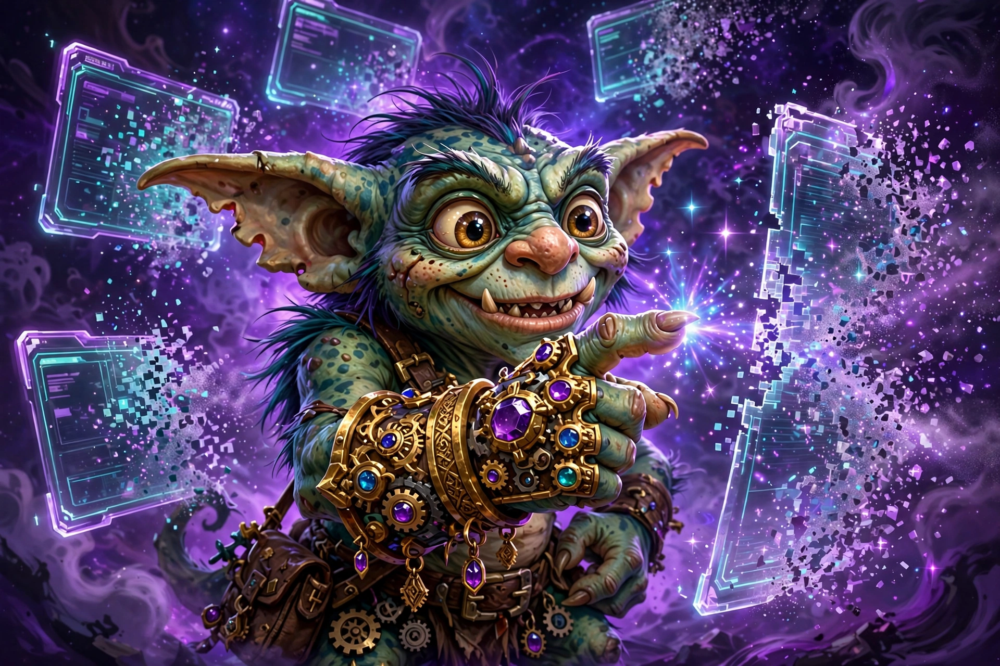

# claude-memes-skills

**Tests fail → Thanos. All green → LeBron. Your terminal, with feelings.**



[](https://github.com/Zion-sewers/claude-memes-skills/actions/workflows/ci.yml)
[](LICENSE)

One small Rust binary that makes Claude Code sessions fun. It registers as shell hooks, matches tool payloads to workflow events, and renders the matching meme GIF inline in your terminal. No popups. No yt-dlp. No ffmpeg.

22 curated events out of the box: `tests_all_pass` → LeBron, `red_phase` → Thanos, `friday_deploy` → This-Is-Fine, `desperation` → Matrix-dodge. Anything unmapped gets embedded locally (auto mode, default on) against 41 emotion hubs with a 30MB on-device model. It also serves `find_meme` / `play_meme` over MCP stdio, and ships Codex/Cursor adapters.

This repo is the fun surface of Zion — and the home of our monster mascots. New meme drops land here first.

## 60 seconds

```bash
cargo install --path .
export GIPHY_API_KEY=<your-key>
claude-memes doctor
claude-memes list
claude-memes play tests_all_pass --force
claude-memes install   # patches ~/.claude/settings.json, backs up first
```

Then break something: `claude-memes find "cargo build exploded with 47 errors"`.

## What it does

- Event detection as pure functions — unit-testable without Claude Code.
- Per-event cooldowns plus an hourly auto budget. Never spammy.
- Hooks: `PostToolUse` (Bash, Skill), `PostToolUseFailure`, `Notification`, `Stop`. Always exits 0, never blocks your session.
- Watch daemon renders GIFs inline through `/dev/tty`.
- Add your own meme: copy an `[events.<name>]` block in `events.toml` — a Giphy `query` plus a `trigger` comment. No URLs, no downloads.

## Honest limits

- Needs a `GIPHY_API_KEY`. No offline fallback yet.
- Cursor adapter is observe-only. Codex adapter is experimental. MCP serving is undocumented.
- Not on crates.io yet. Render latency unmeasured.

---

Part of [Zion](https://github.com/Zion-sewers) — public infrastructure for trust in agents. The eval layer for the long-horizon era. This one is the joy layer.
